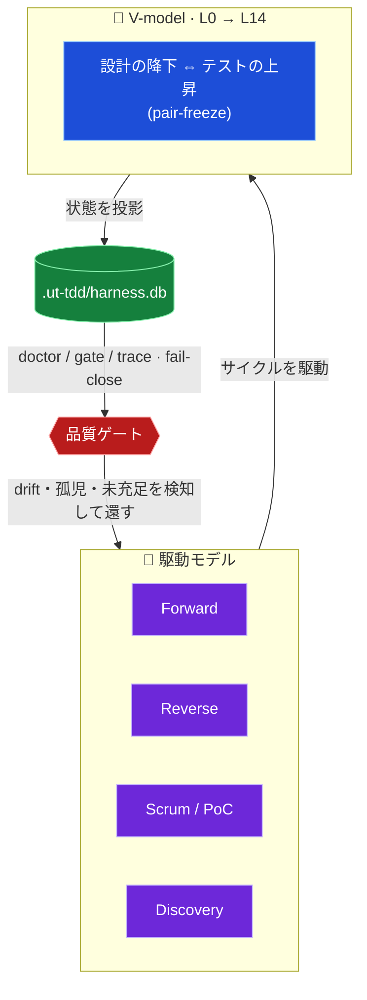
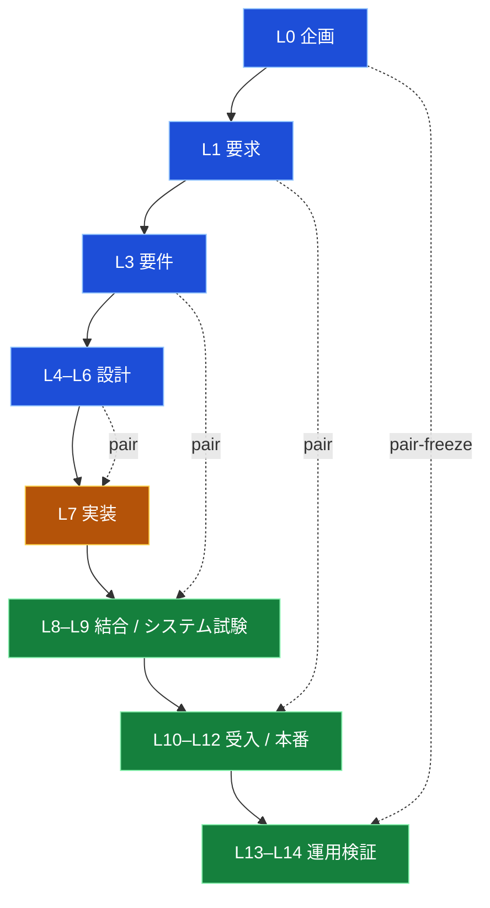
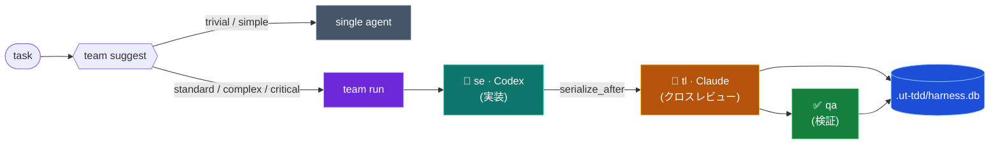

<p align="center">
<picture>
  <source media="(prefers-color-scheme: dark)" srcset="docs/reference/readme-assets/hero-dark.svg">
  
</picture>
</p>

# UT-TDD Agent Harness

<p align="center">AI の「完了しました」を、テストと機械 gate で検証し直す基盤です。</p>

<p align="center">
  <picture>
    <source media="(prefers-color-scheme: dark)" srcset="docs/reference/readme-assets/story-dark.svg">
    
  </picture>
</p>

1 つのセルの中で、書き手が作ったものを別の家系のレビュー役が確かめ、差し戻されたら同じ PR の中で直します。たくさんのセルの成果が CI の門を通って積み上がり、城になります。

## 🧭 何か

AI の「完了しました」を、テスト・証跡・機械 gate で検証し直す基盤です。
V-model / TDD ガバナンス、`doctor`、ハンドオーバー、provider アダプタ、Claude / Codex のチーム委譲を、ローカルの TypeScript / Node.js で回します。
完成品アプリではなく、プロダクト開発を安全にするための土台です。

## 👥 誰向けか

社内で、Claude Code や Codex にプロダクトの実装を任せる開発者です。
いま使っているリポジトリに、release asset から runtime を入れて使います。

## 📋 前提

> [!NOTE]
> release asset の導入に必要なのは Node.js、git、origin remote の 3 つだけです。provider の API キーは要りません。

| 要件 | 確認コマンド | 備考 |
|---|---|---|
| Node.js (`>=24.22.3 <25`) | `node -v` | 必須。release asset はこの Node だけで動きます (`npm ci` は不要) |
| git | `git --version` | 必須 |
| 入れる先の git repository と origin remote | `git remote -v` | 必須。origin が無いと、setup は runtime を入れたうえで exit 2 (`identity_repository_unbound`) で終わります |
| Claude Code / Codex CLI | `claude --version` / `codex --version` | 任意。hook と委譲を使う場合 |

動作保証環境は Windows です。Linux / WSL2 はベストエフォートで、CI と公開前のリハーサルでは確かめていますが、版ごとの正式な受入は必要が出てきた時点で行います ([#928](https://github.com/unison-ai-product/UT-TDD_AGENT-HARNESS/issues/928))。macOS は検証していません。

## 🚀 最短の導入手順

詳しい手順 (既存プロジェクトへの投影、動作確認チェックリスト、トラブルシューティング) は [セットアップガイド](docs/reference/setup-guide.md) にあります。

1. [Releases](https://github.com/unison-ai-product/UT-TDD_AGENT-HARNESS-Pack/releases) から、使いたい版の asset を 5 つともダウンロードして、**新しく作った空のフォルダ**に置きます。そのフォルダには、この 5 つ以外のファイルを置かないでください (ほかのファイルがあると、setup が `consumer_runtime_asset_set_mismatch` で止まります)。
   - `<版>.ut-tdd.mjs`
   - `<版>.consumer-runtime.json`
   - `<版>.consumer.sha256`
   - `<版>.tar.gz`
   - `<版>.tar.gz.sha256`
2. 入れたいリポジトリで、次を実行します (Windows の PowerShell でもそのまま使えるように、1 行で書いています)。`<consumer anchor>` には、その版の release notes にある consumer anchor (`sha256:...`) を入れてください。

```sh
echo ".ut-tdd/" >> .git/info/exclude   # runtime の状態を git の差分に出さない
node <フォルダ>/<版>.ut-tdd.mjs setup --solo --consumer-runtime-release <フォルダ> --expected-consumer-digest <consumer anchor>
```

Windows PowerShell では、1 行目の代わりに `Add-Content -Encoding ascii .git/info/exclude ".ut-tdd/"` を使ってください (`>>` だと UTF-16 で書き込まれ、git が読めません)。

setup は、asset の SHA-256 が consumer anchor と一致することを確かめてから、runtime を `.ut-tdd/` に入れます。
一致しなければ (`consumer_runtime_anchor_mismatch`)、何も書かずに止まります。
入ったあとは、リポジトリの中で `node .ut-tdd/bin/ut-tdd.mjs <command>` を使います。Claude Code (VS Code 拡張を含む) と Codex の hook も、この runtime を呼びます。
動作確認は `node .ut-tdd/bin/ut-tdd.mjs doctor --setup-smoke` で行います。

> [!TIP]
> 失敗したときは、先に [セットアップガイド §5 の対処表](docs/reference/setup-guide.md#5-困ったとき) を見てください。`consumer_runtime_anchor_mismatch`、`consumer_runtime_asset_set_mismatch`、`identity_repository_unbound` などの対処が載っています。

asset が途中で壊れていないかは、手元で SHA-256 を計算して確かめられます。
PowerShell では `Get-FileHash -Algorithm SHA256 <file>`、Git Bash や Linux では `sha256sum <file>` を使います。
各版の release notes には、5 つの asset の sha256 の表を載せる運用です。計算値と表を照らし合わせてください。

setup の再実行は**非破壊**です。あなたが所有するファイルは上書きしません (対話シェルではファイルごとに `[y/N]` で確認し、既定は N。非対話シェルでは常に既存のファイルを残します)。adapter doc は managed block の中だけを更新し、`.ut-tdd/` の runtime 状態は消しません。詳細は [セットアップガイド §4](docs/reference/setup-guide.md) にあります。

## 🚧 いまの版の制約

> [!WARNING]
> 最新の canary 版には、次の既知の制約があります。版ごとの変更点と解消状況は、各版の release notes を見てください。
> - release asset から入れた環境では、`ut-tdd status` の更新通知が動きません。`update: check skipped (harness package.json unreadable)` と表示されます ([#867](https://github.com/unison-ai-product/UT-TDD_AGENT-HARNESS/issues/867))。
> - 一度入れた runtime を、新しい版の asset で上書き (その場で更新) することはできません。setup が `consumer_runtime_update_unsupported` で止まり、元の版のまま残ります ([#930](https://github.com/unison-ai-product/UT-TDD_AGENT-HARNESS/issues/930))。新しい版へ移るには、[新しい clone へ入れ直す手順](docs/reference/setup-guide.md#新しい-clone-へ入れ直す手順) に従ってください。
> - hybrid (Claude と Codex の併用) では、相手ランタイムの返事が、対話中のセッションに自動では届きません (Pack の Issue #13)。送る側は、返事を書いたあとに `ut-tdd memory add --notify-claude ...` で知らせてください (導入先の `AGENTS.md` にも同じ案内が入ります)。受け取る側が自分で気づく仕組みは、まだありません ([#1970](https://github.com/unison-ai-product/UT-TDD_AGENT-HARNESS/issues/1970))。
> - 記録用 hook の所要時間が長い環境があります (Pack の Issue #12)。hook の上限は 30 秒に上げ、SessionStart の処理は軽くしました ([#1938](https://github.com/unison-ai-product/UT-TDD_AGENT-HARNESS/issues/1938))。ただし、hook の中身の軽量化は途中です ([#1057](https://github.com/unison-ai-product/UT-TDD_AGENT-HARNESS/issues/1057))。負荷の高い環境では、まだ上限を超えて cancel されることがあります。

## 🔄 バージョン更新

新しい版は、Pack の [Releases](https://github.com/unison-ai-product/UT-TDD_AGENT-HARNESS-Pack/releases) で公開します。変更点は、各版の release notes に書きます。
新しい版を知るには、GitHub で Pack リポジトリを **Watch → Custom → Releases** に設定してください。公開したときに通知が届きます。
その場での更新はできないため、新しい版へは入れ直します (上の「いまの版の制約」を見てください)。

## 🐞 バグ報告

困ったことや、期待と違う動きがあったら、Pack repo の [Issues](https://github.com/unison-ai-product/UT-TDD_AGENT-HARNESS-Pack/issues/new) から報告してください。

タイトルは「[版] 何をしたら何が起きたか」の形にして、1 行で書いてください。
本文には次の項目を書いてください。分からない項目は「不明」で構いません。

1. 版 (release の tag 名)
2. OS (Windows / Linux / WSL) と、その版
3. `node -v` の出力
4. 実行したコマンド (そのままコピーしたもの)
5. 起きたこと (エラーの出力は全文)
6. 期待していたこと
7. 再現手順と、もう一度やっても同じになるか
8. どこから使ったか (VS Code の Claude 拡張 / terminal / Codex)

**この repository は公開されています。**API キー、token、パスワード、個人情報、社外秘のコードは貼らないでください。
ログにこれらが含まれていたら、`***` などに伏せてから貼ってください。`.ut-tdd/` の中身を最初から丸ごと添付する必要はありません。
調べるのに追加のファイルが必要なときは、こちらから個別にお願いします。

## 📚 コマンド早見表 (利用者向け)

入れたあとは、リポジトリの中の `node .ut-tdd/bin/ut-tdd.mjs` が入口です。次の表の `ut-tdd` は、これに読み替えてください。

| コマンド | 用途 |
|---|---|
| `ut-tdd setup --solo` | 対象リポジトリの初期化 (ソロ) |
| `ut-tdd setup --team --tl-team @org/tl --qa-team @org/qa --po-team @org/po` | チーム開発の初期化 (3 つのチームはセットで指定。まず `--dry-run` で確認する) |
| `ut-tdd status` | 実行モード検出 (`standalone` / `claude-only` / `codex-only` / `hybrid`) |
| `ut-tdd doctor --setup-smoke` | setup 投影物と hook wrapper の最小検証 |
| `ut-tdd doctor` | 設計文書を持つ対象リポジトリのガバナンス一括検証 (gate / trace / drift / roadmap) |
| `ut-tdd db rebuild --json` | `harness.db` の再投影 |
| `ut-tdd vmodel lint` | V-model trace (設計 ⇔ テストの pair) の検証 |
| `ut-tdd review --uncommitted` | 未コミット変更のレビューパケット生成 |
| `ut-tdd task classify --text "…"` | タスク難易度の分類 |
| `ut-tdd skill suggest --text "…"` | 自由記述に対するスキル提案 |
| `ut-tdd team suggest --task "…"` | チーム起動要否の判定 |
| `ut-tdd team run --definition <yaml>` | チーム launch plan の構築 / 実行 |
| `ut-tdd codex --role <role> --task "…"` / `ut-tdd claude …` | provider 委譲 (worker / reviewer)。`--execute` で実 CLI 起動、既定は dry-run |
| `ut-tdd route eval --signal <signal>` | signal を mode / 推奨コマンドへ routing |
| `ut-tdd handover` | ハンドオーバー (機械 + 明示) の生成 |
| `ut-tdd feedback list` / `pending` | `harness.db` の引き継ぎ feedback / Recovery 起票候補を surface |
| `ut-tdd graph impact` / `export` | クロス成果物リレーショングラフの影響分析 / 図出力 (mermaid / dot) |
| `ut-tdd verify recommend` / `run --profile <id>` | 変更ファイルからの検証プロファイル推奨 / 実行 (`mcp profile list` で一覧) |
| `ut-tdd telemetry scan --json` | コストテレメトリの走査 |

## 🧬 コンセプト

AI エージェントは速いです。速いぶん、**「とりあえず動く」へ一直線に走ります**。
後から「ここ、誰が保証したんだっけ」となる瞬間のために、AI の「完了しました」をテスト・証跡・機械 gate で受け止め直す土台を作りました。

### 6 本の柱

| | 柱 | 内容 |
|:--:|---|---|
| 1 | **Foundation first** | 下流のプロダクト開発を安全にする土台を先に固める |
| 2 | **Document-first + 機械強制** | ワークフロー規約を schema / lint / doctor / hook / test で裏打ちする |
| 3 | **自動の状態とフィードバック** | `.ut-tdd/` と `harness.db` で進捗・gap・drift を見える化する |
| 4 | **動的コンテキスト / スキル注入** | 必要なコンテキストとスキルだけを、必要なタイミングで渡す |
| 5 | **実用本位のオーケストレーション** | リスク・コストが下がる場面だけ、役割と runtime を分ける |
| 6 | **厳格な検証** | テストか明示証跡なしに「完了」を通さない |

### しばくべし AI の○○行動

AI には、ありがちな悪癖があります。UT-TDD Agent Harness は、それを人間の根性ではなく機械のルールで受け止めます。

| しばくべき AI の○○行動 | よくある症状 | しばく機能 |
|---|---|---|
| 🤖 **完了詐称行動** | 「完了しました!」と言うが、証跡は無い | `ut-tdd doctor` / 厳格検証: テスト・証跡なしに完了を通さない |
| 🏃 **見切り発車行動** | 考えるより先に手が動き、とりあえず作る | `ut-tdd task classify` → `team suggest`: 着手前に難易度と編成を判定 |
| 🧟 **書き逃げ行動** | 実装だけ済ませ、設計ドキュメントを残さない | **Reverse 駆動** `R0 → R4` で設計・要件を back-fill |
| 🪓 **越境行動** | スコープ外を触り、他人の編集を壊す | `serialize_after` + agent-guard +「他人の編集を revert しない」 |
| 🪞 **自画自賛行動** | 自分の実装を、自分でレビューして合格させる | **hybrid クロスレビュー**: worker ≠ reviewer を別 provider に分離 |
| 💸 **富豪行動** | 何でも最上位モデルでぶん回す | 決定論的モデル選択: 難易度から model / effort を自動決定 |
| 🧠 **健忘行動** | 文脈を忘れ、引き継ぎが雑になる | `ut-tdd handover`: 機械 + 明示の 2 系統で残す |
| 🔑 **鍵ばらまき行動** | API キーやシークレットを平気でコードに書く | 鍵を持たない設計: provider 認証は公式 CLI 側に置く |
| 📊 **見せかけ行動** | カウントは緑、でも中身が伴っていない | 「被覆 ≠ 中身」+ `harness.db` 投影 + doctor の fail-close |

### コンセプト — 品質を守るサイクル

このハーネスの核心は、**V-model** と **駆動モデル** を **`harness.db`** へ投影し、品質を機械的に守ることです。

<picture>
  <source media="(prefers-color-scheme: dark)" srcset="docs/reference/readme-assets/cycle-dark.svg">
  
</picture>

駆動モデル (Drive) が V-model を回し、状態を `harness.db` へ投影し、gate が drift・孤児・未充足を検知して Drive へ還します。

**宣言ではなく機械で守る。** 「被覆(ID 登録)」と「中身(descent)」を分け、未充足・孤児・drift を `doctor` が **fail-close** で止めます。カウントだけが緑でも、中身が無ければ通しません。

### V-model(L0 → L14)

設計の降下(左腕)とテストの上昇(右腕)が **pair-freeze** で1対1に対応します。

設計の降下 (L0 要求から L7 実装まで) と、テストの上昇 (L8 結合から L14 運用検証まで) が対応します。図は下の「図の元 (mermaid)」にあります。

### 駆動モデル

タスクの性質に応じて、**招集する専門職とサイクル**を切り替えます。通常開発、既存実装からの逆流、PoC、復旧を同じ土台で扱います。

| 駆動 | サイクル | 使いどころ |
|---|---|---|
| **Forward** | `plan → pair-freeze → implement → trace-freeze → review → accept` | 通常の前進開発 |
| **Reverse** | `R0 → R1 → R2 → R3 → R4 → Forward merge` | 既存実装から設計/要件を back-fill |
| **Scrum / PoC** | `S0 backlog → S1 plan → S2 poc → S3 verify → S4 decide` | 不確実性の検証・意思決定 |
| **Discovery** | 必須 + 駆動モデル合成 → exit | メタ的な workflow 探索・triage |
| **Recovery / Troubleshoot** | 復旧 → 認識合わせ → 上流から修正 → fullback | 暴走・強制停止・前提崩れからの立て直し |

### タスクの流れ(チーム委譲)

<picture>
  <source media="(prefers-color-scheme: dark)" srcset="docs/reference/readme-assets/team-dark.svg">
  
</picture>

`team suggest` が trivial / simple と判定したタスクは単独の agent で、standard 以上は `team run` で se (Codex が実装) → tl (Claude がクロスレビュー) → qa (検証) の順に流します。

worker と reviewer を**別 provider**(Codex ↔ Claude)に割り当て、同一モデルによる自己承認を防ぎます。

<details>
<summary>図の元 (mermaid)</summary>







</details>

## 🔧 開発者向け: ハーネス自体を開発するとき

ここから先は、ハーネス自体を開発・検証する人向けです。source 開発 repo の checkout 上では、`node src/cli.ts <command>` または `scripts/ut-tdd <command>` で直接実行します。

### コマンド早見表 (source 開発者向け)

| コマンド | 用途 |
|---|---|
| `ut-tdd distribution plan` | clean 配布の export / preflight / rollback 計画 (実カットは PO 承認が必要) |
| `ut-tdd distribution sync-stage --out <dir>` | clean Pack artifact set をローカル staging directory に materialize し、配布対象外ファイルを検出 |
| `ut-tdd distribution sync-pack --repo-dir <Pack checkout>` | 既存 Pack checkout へ clean artifact set だけを同期 (余剰ファイルは `--prune-local` 明示時のみ削除) |
| `ut-tdd distribution package --out .ut-tdd/release` | clean 配布 tarball / sha256 / manifest をローカル生成 (署名・公開は外部承認が必要) |

Pack 反映は source 開発 repo から直接 push しません。`sync-pack` は Pack checkout へファイルをコピーし、`git status` / `commit` / `push` の次コマンドを表示するだけです。`docs/plans`、`docs/design`、`docs/test-design`、`.ut-tdd`、dogfood 監査 doc、runtime DB、開発 UI は Pack artifact に入りません。`docs/skills/*` は Pack では root `skills/*` に写像されます。

<details>
<summary><b>ハーネス自体を開発・検証するとき (Pack checkout)</b></summary>

<br>

普段使うときは、クイックスタートの release asset からの導入を使ってください。ここに書いているのは、ハーネス自体を開発・検証するときの使い方です。

Pack を clone して依存を入れ、checkout の上で直接実行します:

```sh
git clone https://github.com/unison-ai-product/UT-TDD_AGENT-HARNESS-Pack.git
cd UT-TDD_AGENT-HARNESS-Pack
npm ci
node src/cli.ts setup --solo
node src/cli.ts doctor --setup-smoke
```

ブランチ保護は既定では出力するだけです。適用するときは、人間 / 管理者が明示的に次を実行します:

```sh
scripts/setup-branch-protection.sh
```

full `doctor` (フラグなし) は、対象 repository に UT-TDD の設計 doc / PLAN / test-design がそろった後のガバナンス検証です。
まだ設計文書を持たない repository の導入判定には、`doctor --setup-smoke` を使います。

</details>

<details>
<summary><b>日常コマンド</b></summary>

<br>

```sh
scripts/ut-tdd doctor
scripts/ut-tdd db rebuild --json
scripts/ut-tdd telemetry scan --json
scripts/ut-tdd team suggest --task "production security schema migration" --mode hybrid --json
scripts/ut-tdd team run --definition .ut-tdd/teams/team.yaml --mode hybrid --json
```

`--execute` は、provider CLI を実際に起動すべきときだけ使います:

```sh
scripts/ut-tdd team run --definition .ut-tdd/teams/team.yaml --mode hybrid --execute
```

</details>

<details>
<summary><b>チーム定義</b></summary>

<br>

```yaml
name: speed-team
strategy: parallel
max_parallel: 2
members:
  - role: se
    engine: codex-se
    task: implement the adapter change
  - role: tl
    engine: pmo-sonnet
    task: review the adapter change
    serialize_after: se
```

任意のメンバーフィールド:

- `difficulty`: `trivial`、`simple`、`standard`、`complex`、`critical` のいずれか
- `model`: 明示的な model 上書き。受け付ける値は provider の ID / ファミリ: `gpt-*`、`claude-*`、`codex-*`、`haiku`、`sonnet`、`opus`、`local`
- `effort`: `low`、`medium`、`middle`、`high`、`xhigh` のいずれか。Claude 実行時は provider 境界で `middle` は `medium`、`xhigh` は `high` に正規化します。

省略した場合、ハーネスはタスクテキストから難易度を推論し、launch plan に `model_selection` を記録します。`serialize_after` は依存制御で、ランナーは依存先を先に並べ、依存先が失敗したら依存元をスキップします。

</details>

<details>
<summary><b>サブエージェントを起動するタイミング</b></summary>

<br>

タスクの出所が自由記述テキストのときは、`team run` の前に `team suggest` を使います:

```sh
scripts/ut-tdd team suggest --task "subagent runtime adapter refactor" --json
```

ポリシーは決定論的です:

- `trivial` と `simple` のタスクは、リスク用語を含まない限りシングルエージェントのままです。
- `standard`・`complex`・`critical` のタスクは、`hybrid` モードでクロス provider チームを推奨します。
- `auth`、`database`、`doctor`、`migration`、`production`、`runtime`、`schema`、`security`、`subagent`、`windows` などのリスク用語は、`hybrid` モードでチーム推奨を強制します。
- `hybrid` 以外のモードでは `should_launch=false` と `trigger="unavailable"` を返します。ハーネスはクロス provider レビューを黙って偽装しません。
- `complex` と `critical` の推奨では、レビュアー作業を実装の後ろに直列化します。`critical` ではさらに QA 検証者を追加します。

返される `definition` は `.ut-tdd/teams/<name>.yaml` として保存するか、`team run` が使うのと同じスキーマに渡せます。

</details>

<details>
<summary><b>Provider 境界</b></summary>

<br>

通常の入口は `ut-tdd codex` / `ut-tdd claude`(`--role` 委譲ラッパ)です。raw な `codex exec` / `claude --print` を直接の常用経路にはしません。以下は、そのラッパが内部で起動する provider CLI の形です。

model が選択されている場合、Codex は `codex exec -m <model> -` として起動し、Claude は `claude --print --input-format text --model <model> --effort <low|medium|high>` として起動します。どちらもタスク本文は argv ではなく stdin で渡します。Claude は provider-safe な effort 値を `CLAUDE_CODE_EFFORT_LEVEL` でも受け取ります。Codex の reasoning effort は決定論的に選択され、対応する Codex CLI の effort フラグが確定するまでは証跡 / プロンプトのメタデータに記録されます。

managed なアダプタ呼び出しでは、ハーネスは legacy の raw-provider ガード環境マーカーを provider 実行前に**剥がし、それらを渡しません**。provider の認証情報は各公式 CLI のログインが保持し続けます。

</details>

## 🌐 English Summary

UT-TDD Agent Harness is a verification and development foundation for running
AI implementation agents safely in team development. It combines a V-model
document descent, a drive model, and a deterministic `harness.db` projection.
Install it from the Pack release assets (see the setup guide above); docs are
written in Japanese by an internal project rule.

## 📄 License

Apache License, Version 2.0.

Copyright 2026 UNISON-TECHNOLOGY

Licensed under the Apache License, Version 2.0. See [`LICENSE`](./LICENSE) for
the full license text and [`NOTICE`](./NOTICE) for attribution notices that
must accompany redistributions.

## ✅ 検証

Pack / consumer checkout での既定検証:

```sh
npm run typecheck
npm run lint
npm run test
```

Pack の `test` は `test:pack` と同じ配布安全 smoke に固定されています。source repo 専用の
governance docs、PLAN、`.ut-tdd` runtime state、harness DB を必要とするフル検証は含みません。
Pack CI や consumer repo では raw `vitest run` を直接使わず、`npm run test` または
`npm run test:pack` を使います。raw `vitest run` / source `npm run test` の全量回帰は
source development repo 専用です。

Source development repo での追加検証:

```sh
npm run typecheck
npm run lint
npm run test:fast
npm run test:db
npm run test:cli
npm run test
npm run test:node-fallback
scripts/ut-tdd doctor
```

**ヒント**: plan やドキュメントの変更後に `.ut-tdd/harness.db` が古くなっている場合、`doctor` は失敗する想定です。
`node src/cli.ts db rebuild --json` で投影を再構築してから `doctor` を再実行してください。
